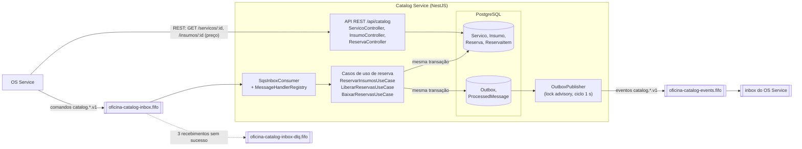
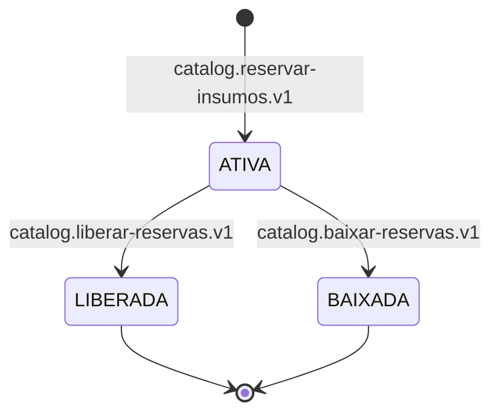

# tc-fase4-catalog — Catalog Service

[](https://sonarcloud.io/summary/new_code?id=Os-Desacoplados-Pos-Tech-SOAP-FIAP_tc-fase4-catalog)
[](https://sonarcloud.io/summary/new_code?id=Os-Desacoplados-Pos-Tech-SOAP-FIAP_tc-fase4-catalog)
[](https://sonarcloud.io/summary/new_code?id=Os-Desacoplados-Pos-Tech-SOAP-FIAP_tc-fase4-catalog)
[](https://sonarcloud.io/summary/new_code?id=Os-Desacoplados-Pos-Tech-SOAP-FIAP_tc-fase4-catalog)
[](https://sonarcloud.io/summary/new_code?id=Os-Desacoplados-Pos-Tech-SOAP-FIAP_tc-fase4-catalog)

Microsserviço do **catálogo de serviços e insumos** da oficina e dono do **estoque**.
Na saga da OS, reserva os insumos depois da aprovação do orçamento, libera a reserva quando
a saga compensa e baixa o estoque depois da execução.

Stack: NestJS 10, TypeScript, PostgreSQL 16, Prisma 5, SNS/SQS FIFO (AWS SDK v3), Pino, OpenTelemetry.

## Responsabilidades

| Recebe (comando, fila `oficina-catalog-inbox.fifo`) | Publica (evento, tópico `oficina-catalog-events.fifo`) |
|---|---|
| `catalog.reservar-insumos.v1` — tudo ou nada | `catalog.insumos-reservados.v1` ou `catalog.reserva-insumos-falhou.v1` |
| `catalog.liberar-reservas.v1` — compensação | `catalog.reservas-liberadas.v1` |
| `catalog.baixar-reservas.v1` — após a execução | `catalog.estoque-baixado.v1` |

### API REST

Prefixo `/api/catalog`; Swagger em `/api/catalog/docs`. Autenticação por JWT (HS256) com claim `perfil`.

| Recurso | Operações | Perfis |
|---|---|---|
| `servicos` | `POST`, `GET`, `GET /:id`, `PUT /:id` | escrita: ADMINISTRADOR; leitura: ADMINISTRADOR, ATENDENTE, MECANICO |
| `insumos` | `POST`, `GET`, `GET /:id`, `PATCH /:id/estoque` | escrita: ADMINISTRADOR, MECANICO; leitura: ADMINISTRADOR, ATENDENTE, MECANICO |
| `reservas?osId=<uuid>` | `GET` | ADMINISTRADOR, ATENDENTE, MECANICO |
| `health` | `GET` | público |

`GET /reservas` exige `osId` em formato UUID (400 caso contrário). `GET /insumos/:id` é usado pelo OS Service para precificar itens.

### Erros

Corpo padronizado: `{ statusCode, error, code, message }`.

| Causa | Status |
|---|---|
| Validação de entrada / UUID inválido | 400 |
| `RecursoNaoEncontradoError` | 404 |
| `ConflitoError` (inclui código de insumo duplicado, via Prisma `P2002`) | 409 |
| `DomainError` (regra de negócio, ex.: estoque insuficiente) | 422 |

## Arquitetura

O Catalog recebe comandos da saga pela inbox SQS FIFO, aplica a regra de estoque em transação no PostgreSQL e
devolve o resultado como evento via outbox. A API REST atende o cadastro e a consulta de preço feita pelo OS.



Ciclo de vida da `Reserva`: nasce `ATIVA` e termina `LIBERADA` (compensação da saga) ou `BAIXADA` (após a execução).



- Camadas DDD: `domain` (Servico, Insumo, Reserva) → `application` (casos de uso e portas)
  → `infrastructure` (Prisma, SNS/SQS, JWT) e `modules` (HTTP e handlers de mensagem).
- **Banco próprio:** PostgreSQL (consistência forte para a reserva de estoque).
- **Observabilidade:** logs estruturados (Pino) com `osId`/`messageId`; `authorization` e `cookie` são
  redigidos. Traces/métricas OpenTelemetry via OTLP quando `OTEL_EXPORTER_OTLP_ENDPOINT` está definido.

### Reserva de estoque

- **Tudo ou nada:** a reserva de uma OS só é criada se todos os itens têm saldo; senão nada é alterado e
  `catalog.reserva-insumos-falhou.v1` é publicado.
- **Concorrência:** os insumos são travados com `SELECT … FOR UPDATE` em ordem de `id` (evita deadlock);
  duas OS nunca reservam a mesma unidade (teste `reserva-concorrencia`).
- **Uma reserva ATIVA por OS:** garantida por índice único parcial no banco.
- **Idempotência:** cada `messageId` é registrado em `ProcessedMessage` na mesma transação do efeito.

### Outbox (publicação)

O evento é gravado na mesma transação do efeito e publicado por um worker (ciclo de 1 s, lotes de 10).

- **Publicador único ativo:** `pg_try_advisory_xact_lock`; réplicas sem o lock esperam o próximo ciclo.
- **Destino por mensagem** (padrão: tópico próprio) e `traceparent` capturado na escrita, enviado como
  `MessageAttribute` do SNS/SQS para manter o trace da saga.
- **Ordem por OS:** a seleção é feita em rodadas com a cabeça de cada OS (`DISTINCT ON (groupId)`) ordenada
  por `seq`, com as OS sem falhas anteriores primeiro. Uma mensagem que falha bloqueia **somente a própria OS**
  (`tentativas` e `ultimoErro` são registrados).
- **Tempo de envio limitado:** clientes de publicação dedicados (timeout 3 s, 2 tentativas), timeout da
  transação de 20 s e orçamento de 5 s para iniciar novos envios no ciclo.

### Inbox (consumo)

- Consumidor SQS FIFO com long-poll; `MessageGroupId = osId` preserva a ordem da saga por OS.
- Após uma falha, as demais mensagens da mesma OS no lote são puladas (ordem preservada).
- Mensagens inválidas ou desconhecidas **não são apagadas**: voltam após o visibility timeout e vão para a
  DLQ após 3 recebimentos (`maxReceiveCount = 3`).
- **Shutdown gracioso:** `beforeApplicationShutdown` aborta o long-poll e aguarda o lote corrente;
  o Prisma desconecta em `onApplicationShutdown`.

### Trade-offs conhecidos

- As mensagens da mesma OS puladas após uma mensagem "poison" acumulam contagem de recebimento e também
  podem chegar à DLQ (cascata). Correção operacional: redrive da DLQ após resolver a causa.
- `Outbox` e `ProcessedMessage` crescem indefinidamente; limpeza/retenção está fora do escopo atual.

## Rodando localmente

```bash
cp .env.example .env                 # ajuste JWT_SECRET
npm ci
docker compose up -d                 # Postgres (5434) + LocalStack (SNS/SQS FIFO, topologia criada no boot)
npx prisma migrate deploy
npm run build && npx prisma db seed  # serviços e insumos com ids fixos
npm run start:dev                    # http://localhost:3002/api/catalog/docs
```

### Variáveis de ambiente

| Variável | Descrição |
|---|---|
| `PORT` | Porta HTTP (local: `3002`) |
| `DATABASE_URL` | Conexão PostgreSQL |
| `JWT_SECRET` | Segredo HS256 compartilhado entre os serviços |
| `MESSAGING_ENABLED` | `false` desliga inbox/outbox |
| `AWS_REGION`, `AWS_ENDPOINT_URL` | Região; endpoint só em dev (LocalStack) |
| `INBOX_QUEUE_URL` | URL da fila FIFO de entrada |
| `EVENTS_TOPIC_ARN` | ARN do tópico FIFO de eventos (destino padrão do outbox) |
| `OTEL_EXPORTER_OTLP_ENDPOINT`, `OTEL_SERVICE_NAME` | Observabilidade (vazio = desligado) |

### Seed

IDs fixos, referenciados pelo OS Service e pelas coleções de requisições. O seed é idempotente (`upsert`).

| Tipo | Id | Código / nome | Estoque |
|---|---|---|---|
| Serviço | `a1000000-0000-4000-8000-000000000001` | Troca de óleo (R$ 120) | — |
| Serviço | `a1000000-0000-4000-8000-000000000002` | Alinhamento e balanceamento (R$ 150) | — |
| Serviço | `a1000000-0000-4000-8000-000000000003` | Revisão de freios (R$ 200) | — |
| Insumo | `b2000000-0000-4000-8000-000000000001` | FIL-001 Filtro de óleo (R$ 45) | 20 |
| Insumo | `b2000000-0000-4000-8000-000000000002` | OLE-5W30 Óleo 5W30 litro (R$ 60) | 50 |
| Insumo | `b2000000-0000-4000-8000-000000000003` | PAS-001 Pastilha de freio (R$ 180) | **0** (cenário (b) da saga: reserva falha) |
| Insumo | `b2000000-0000-4000-8000-000000000004` | FLU-DOT4 Fluido de freio DOT4 (R$ 40) | 10 |

## Testes

| Script | Escopo |
|---|---|
| `npm test` | Unitários (`src/**/*.spec.ts`) |
| `npm run test:int` | Integração com PostgreSQL real (repositórios, rollback, outbox, concorrência) |
| `npm run test:e2e` | HTTP + mensageria ponta a ponta |
| `npm run test:cov` | Todos os projetos com cobertura; limite global mínimo de 80% (atual ~96% de linhas) |

Qualidade: `npm run lint:ci` (sem warnings) e `npm run build`.

### Qualidade e cobertura

Painel do projeto no SonarCloud: <https://sonarcloud.io/summary/overall?id=Os-Desacoplados-Pos-Tech-SOAP-FIAP_tc-fase4-catalog>.
O SonarCloud analisa todo PR e o check `SonarCloud Code Analysis` (quality gate) é obrigatório para merge na `main`.

## CI/CD

`.github/workflows/ci.yml` (job `ci`): lint → build → testes com cobertura → build da imagem Docker →
análise SonarCloud. `ci` e `SonarCloud Code Analysis` (quality gate) são checks obrigatórios para merge na `main`.

| Workflow | Gatilho | O que faz |
|---|---|---|
| `ci.yml` (job `ci`) | PR e push na `main` | lint, build, testes, imagem, Sonar |
| `terraform.yml` (job `terraform`) | PR/push que mexe em `terraform/` | `fmt -check`, `init -backend=false`, `validate` |
| `terraform.yml` (job `deploy`) | só **Run workflow** (`plan`/`apply`/`destroy`), com aprovação no environment `aws-infra` | aplica ou destrói os recursos do serviço |
| `cd.yml` | CI verde na `main` ou **Run workflow** | imagem no ECR e deploy no EKS |

## Deploy no EKS

### O que o Terraform do serviço cria (`terraform/`)

State em `s3://tc-fase4-tfstate-538880133939/catalog/terraform.tfstate`; lê a infra
compartilhada de `infra/terraform.tfstate` (`tc-fase4-infra`).

| Recurso | Nome |
|---|---|
| RDS PostgreSQL 16 (`db.t4g.micro`, 20 GB gp3, privado) | `oficina-fase4-catalog` |
| SG do RDS (5432 só a partir dos nodes do EKS) | `oficina-fase4-catalog-rds` |
| Segredo com a `DATABASE_URL` | `oficina-fase4/catalog/DATABASE_URL` |
| Fila FIFO de entrada + DLQ (redrive após 3 recebimentos) | `oficina-catalog-inbox.fifo`, `oficina-catalog-inbox-dlq.fifo` |
| Tópico FIFO de eventos | `oficina-catalog-events.fifo` |
| Role IRSA do pod (consome a inbox, publica no tópico) | `oficina-fase4-catalog` |

Configuração de estudo: sem backup, sem snapshot final e sem proteção contra exclusão. A
assinatura do tópico é feita pelo OS, que é quem consome os eventos.

### Ordem

`tc-fase4-infra` → **catalog** → execution → billing → os → auth → gateway. Para derrubar,
a ordem inversa (o OS assina o tópico do catalog e tem permissão na fila dele).

### Rodar o Terraform

Actions → **Terraform** → **Run workflow** → escolha `plan`, `apply` ou `destroy` → aprove
em **Review deployments**. O `destroy` remove antes o namespace `catalog` do cluster (pods
e Ingress), se o cluster estiver no ar.

### O que o CD faz

1. Usa o SHA que passou no CI; pula com aviso se o cluster `oficina-fase4` não está
   `ACTIVE` ou se o Terraform do catalog não foi aplicado (state sem outputs).
2. Publica a imagem no ECR com tag = SHA (reaproveita se a tag já existe).
3. Cria o Secret `catalog-secret` (`DATABASE_URL`, `JWT_SECRET`, lidos do Secrets Manager)
   e o ConfigMap `catalog-config` (`INBOX_QUEUE_URL`, `EVENTS_TOPIC_ARN`, fixas e, se o
   Alloy estiver instalado, `OTEL_EXPORTER_OTLP_ENDPOINT`).
4. Aplica `k8s/base` com a imagem do ECR, a role IRSA e o SG do ALB; o initContainer
   roda `prisma migrate deploy`. O serviço entra no ALB interno em `/api/catalog`.
5. Espera o rollout, roda o seed (idempotente) e faz um smoke em `/api/catalog/health`
   de dentro do pod.

### Seed

O CD roda `npx --no-install prisma db seed` a cada deploy (`upsert`, não sobrescreve
dados). Para rodar à mão: `kubectl exec -n catalog deploy/catalog -- npx --no-install prisma db seed`.

### Rollback

Automático quando o rollout falha (`kubectl rollout undo`), com `describe` e logs no job.
Manual: `kubectl rollout undo deployment/catalog -n catalog`, ou um `git revert` na `main`
(o CD implanta o commit revertido).
